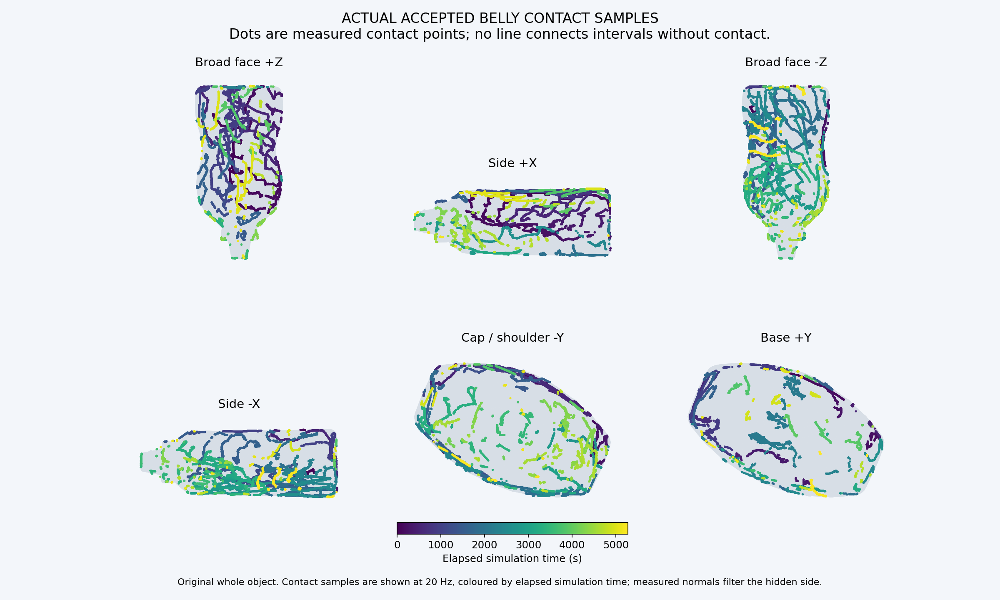

# Mustard 四指协同整瓶遍历 · 2026-10-19

用户接受局部整手主动贴合效果后，要求遍历整个物体。本轮保持MCC-only，并完成宽面、侧面、瓶盖/瓶肩和瓶底覆盖。

| 项目 | 最终记录 |
| --- | --- |
| 案例 | `whole_hand_surface_run10_20261019` |
| 仿真时长 | 5277.036秒 |
| 完整覆盖 | 8192/8192顶点，388/388目标 |
| 原生状态 | 2,638,518个，2ms间隔，266分块 |
| 独立核验 | 从唯一t=0初态连续重放，全部命令双几何守护通过 |
| 滑动阶段至少三指 / 四指接触率 | 77.2113% / 29.1176% |
| 全程各指接触率，食/中/无名/拇 | 50.7130% / 57.2579% / 57.8054% / 47.9259% |
| 各指合格接触时切向材料运动 | 9.088 / 10.128 / 10.388 / 8.152m |
| 最长全手有效接触中断 | 146.156秒 |
| 原始力峰 | 10.000660N |
| ≥8N原始观测 | 18段，累计0.146秒，最长0.040秒；全部不计覆盖 |
| 姿态 | 长指PIP总范围5.580–54.458°，DIP为3.940–42.999° |

覆盖沿用实际安全指腹接触的25mm网格边测地邻域，非皮肤压力足迹。原始完整网格分母和碰撞模型不变。
持续主动控制不等于始终四指同时触碰；所有失联、卸力和换面均保留在轨迹与完整视频中。

这是v4→v6→v7→v8的连续开发接续，三处控制器边界为2260.000、4102.920、5273.000秒。
保留原t=0初态、所有命令与物理状态以及递归来源；不拼接独立试验的覆盖。
2638518个原生状态全轨迹独立核验通过，位置/速度/命令/力/覆盖误差0，法向浮差≤3.34e−16；unsafe=0，臂自碰力0。
末段安全接触保持0.510秒。47项专项回归、两例真实几何回归通过；发布时完整I04回归424项通过。

## 随代码发布的产物

- [中文报告](../generated/whole_hand_surface_run10_20261019/review.html)
- [完整24倍速视频](../generated/whole_hand_surface_run10_20261019/whole_hand_complete_24x.mp4)
- [六方向正常速度节选](../generated/whole_hand_surface_run10_20261019/whole_hand_details_1x.mp4)
- [瓶底特写](../generated/whole_hand_surface_run10_20261019/whole_hand_base_clear_1x.mp4)
- [原始轨迹分块清单](../generated/whole_hand_surface_run10_20261019/trace_chunks.json)
- [独立核验](../generated/whole_hand_surface_run10_20261019/independent_native_audit/audit.json)
- [交付检查](../generated/whole_hand_surface_run10_20261019/delivery_checks.json)
- [完整文件清单与SHA-256](2026-10-19_I04_WHOLE_HAND_SURFACE.json)
- [下载、回放、原生核验与运行说明](../I04_WHOLE_HAND_RUNBOOK.md)

全部原始轨迹与视频使用Git LFS保留；不会只发布降采样预览。当前产物目录也包含少量开发预览，正式展示以 `review.html` 链接的三段视频为准。
可直接下载报告查看；重跑时使用可迁移入口解析历史资产路径，原始证据文件不被改写。

仅验证固定Mustard、零重力仿真；没有验证自由物体、实时计算、硬件或DPRef。最长146.156秒断触仍是明确的换面连续性问题。
